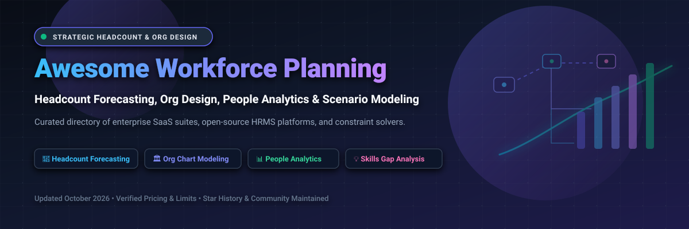

# 🚀 Awesome Workforce Planning

<p align="center">
  
</p>

<p align="center">
  <a href="https://github.com/ishandutta2007/Awesome-Awesome-Awesome"></a><a href="https://discord.gg/jc4xtF58Ve"></a>
  <a href="https://github.com/ishandutta2007/Awesome-Workforce-Planning/stargazers"></a>
  <a href="https://github.com/ishandutta2007/Awesome-Workforce-Planning/network/members"></a>
  <a href="https://github.com/ishandutta2007/Awesome-Workforce-Planning/issues"></a>
  <a href="LICENSE"></a>
  <a href="https://github.com/ishandutta2007"></a>
</p>

---

> **A curated directory of premier Strategic Workforce Planning (SWP), Headcount Forecasting, Organizational Design, and People Analytics SaaS suites alongside battle-tested open-source HRMS platforms, shift rostering constraint solvers, and org-chart visualizers.**

*Empowering HR Leaders, Chief People Officers (CPOs), FP&A Directors, and People Analytics Engineers to forecast hiring needs, model span-of-control hierarchies, mitigate attrition risk, and eliminate disconnected spreadsheet planning.*

---

## 📑 Table of Contents

- [🌐 Sector Overview & Market Dynamics](#-sector-overview--market-dynamics)
- [🏢 SaaS & Hosted Enterprise Workforce Planning Platforms](#-saas--hosted-enterprise-workforce-planning-platforms)
- [💻 Open-Source GitHub Projects (Ranked by Stars)](#-open-source-github-projects-ranked-by-stars)
- [📐 Strategic Workforce Planning Architecture & Methodology](#-strategic-workforce-planning-architecture--methodology)
- [🔍 SEO & Industry Keywords](#-seo--industry-keywords)
- [🤝 How to Contribute](#-how-to-contribute)
- [⚠️ Compliance & Data Governance](#-compliance--data-governance)
- [⭐ Star History](#-star-history)
- [💖 Support & Community](#-support--community)

---

## 🌐 Sector Overview & Market Dynamics

The global **Workforce Planning and Workforce Management Software Market** is estimated at **$8.7 Billion to $11.7 Billion in 2025–2026** and is projected to surpass **$23.5 Billion by 2030**, advancing at a Compound Annual Growth Rate (**CAGR of ~9.8% to 10.4%**), accelerated by continuous headcount budgeting requirements, AI-driven skills taxonomy mapping, and rapid organizational restructuring cycles.

The industry exhibits a **dual structure: moderately concentrated at the top-tier enterprise level**, where global legacy cloud giants (*Oracle, SAP, Workday, and Anaplan*) control more than 45% of Fortune 500 corporate deployments, but **substantially fragmented across mid-market and high-growth sectors**, where agile specialized planning SaaS platforms (*Pigment, Visier, ChartHop, Orgvue*) and extensible open-source platforms provide transparent, modular alternatives to inflexible spreadsheets and multi-year vendor lock-in.

---

## 🏢 SaaS & Hosted Enterprise Workforce Planning Platforms

*The following table catalogs category-defining commercial Workforce Planning and Headcount Modeling platforms. The table is strictly sorted descending by company scale (market capitalization or private valuation).*

| 🏢 Platform / Vendor | 💰 Company Valuation / Revenue | 🏷️ Specific Starting Pricing | 🎁 Specific Free Tier / Trial Limits | ⚡ Core Workforce Planning Capabilities |
| :--- | :--- | :--- | :--- | :--- |
| **[Oracle Strategic Workforce Planning](https://www.oracle.com/human-capital-management/workforce-planning/)** | **~$420 Billion Market Cap** (NYSE: `ORCL`; ~$53.0B FY24 Revenue) | **$250.00 / hosted user / month** (or **$5.25 / employee / month** enterprise metric with ~$30,000/yr minimum annual commitment) | **30-Day Free Trial** with **$300 cloud credits** on Oracle Cloud Infrastructure for sandbox testing; no permanent free tier. | Strategic headcount forecasting, demographic attrition prediction, long-term talent supply-demand gap analysis, deep native integration with Oracle Fusion Cloud HCM & ERP. |
| **[SAP SuccessFactors Workforce Planning](https://www.sap.com/products/hcm.html)** | **~$260 Billion Market Cap** (FWB: `SAP`; ~€31.2B / $34.0B FY24 Revenue) | **$4.50 / user / month** (or ~$54.00/user/year; typical minimum contract threshold ~$25,000/year) | **30-Day Guided Free Trial** of SAP SuccessFactors HCM suite (preconfigured demo tenant with headcount planning templates); no permanent free tier. | Comprehensive operational and strategic workforce planning, retirement risk modeling, restructuring simulations, and real-time reconciliation with SAP S/4HANA finance. |
| **[Workday Workforce Planning](https://www.workday.com/)** | **~$52 Billion Market Cap** (NASDAQ: `WDAY`; ~$8.45B FY25 Revenue) | **$15,000 – $25,000 / year** base annual platform fee (or ~$45.00–$65.00/user/month depending on enterprise scale) | **30-Day Interactive Sandbox Trial** upon sales verification (access to preconfigured headcount models; no self-serve free tier). | Continuous headcount planning against financial budgets, dynamic org modeling, skills taxonomy classification, and real-time headcount variance analytics. |
| **[Anaplan](https://www.anaplan.com/)** | **~$10.7 Billion Valuation** (Acquired by Thoma Bravo; ~$700M+ ARR) | **$30,000 – $50,000 / year** starting contract for Standard Planning tier (model builders ~$1,800/yr, active contributors ~$600/yr, viewers ~$250/yr) | **30-Day Guided Proof-of-Concept (POC)** sandbox environment arranged through enterprise sales or 90-day partner sandboxes; no self-serve free tier. | Multi-dimensional Hyperblock calculation engine, connected headcount planning scenarios, compensation cost modeling, and unified cross-functional HR/finance alignment. |
| **[Pigment](https://pigment.com/)** | **$2.3 Billion Valuation** (Series E in late 2024 / $250M round; $100M+ ARR) | **$25,000 – $50,000 / year** base platform subscription (comprehensive mid-market deployments typically start ~$50,000/year) | **14-Day Custom Proof-of-Concept (POC) Trial** with tailored company datasets configured by solution engineers; no public self-serve free tier. | Intuitive spreadsheet-native modeling, real-time hiring plans, AI-assisted planning agents, organizational span-of-control drilldowns, and collaborative scenario comparison. |
| **[Visier](https://www.visier.com/)** | **~$1.0 Billion Valuation** (Series E unicorn; $100M+ ARR; 8,000+ customers) | **$20,000 / year** base platform minimum (or ~$3.50–$5.00/monitored employee/month for mid-market plans) | **30-Day Free Sandbox Trial** (Visier People evaluation tenant with full admin rights and synthetic benchmark data; no credit card required). | Industry-leading people analytics and strategic workforce planning, flight-risk prediction, skills inventory gap analysis, and external labor benchmark integration. |
| **[Board International](https://www.board.com/)** | **~$850 Million Valuation** (Majority owned by Nordic Capital; ~$148M ARR) | **$25,000 – $35,000 / year** starting annual subscription (user licenses ~$150–$250/user/month depending on role tier) | **30-Day Guided Evaluation Sandbox** provisioned following enterprise discovery consultation; no public self-serve free tier. | All-in-one decision-making and agentic planning platform, multi-scenario headcount forecasting, workforce cost simulations, and direct synchronization with corporate FP&A. |
| **[Planful](https://planful.com/)** | **~$500 Million Valuation** (Backed by Vector Capital; ~$145M ARR) | **$20,000 – $30,000 / year** base platform commitment (user licenses scale ~$2,000–$4,000/user/year) | **30-to-60-Day Scoped Pilot / POC** tenant provided during formal sales evaluations; no self-serve free tier. | Financial and workforce planning integration, headcount and compensation budgeting, fringe benefit calculation, and automated hiring variance reporting. |
| **[ChartHop](https://www.charthop.com/)** | **~$300 Million Valuation** (Series C; ~$74M total funding; ~$8M–$10M ARR) | **$5.00 / employee / month** (ChartHop Core) + ~$3.00/employee/month for Headcount Planning module | **Free Forever Plan** (ChartHop Basic) for up to 35 employees (includes visual org charts, employee directory, and profiles); **14-Day Free Trial** on all paid tiers. | Dynamic real-time org charts, visual headcount planning scenarios, compensation review workflows, employee demographic mapping, and ATS/HRIS sync. |
| **[Orgvue](https://www.orgvue.com/)** | **~$180 Million Valuation** (Concentra Analytics; $60M+ institutional funding; ~$53M ARR) | **$25,000 – $40,000 / year** base enterprise deployment (~$30–$50/monitored employee/year) | **14-Day Guided Sandbox Environment** with pre-configured organizational restructuring templates; no permanent free tier. | Purpose-built organizational design software, span of control optimization, restructuring scenario modeling, future-state skills mapping, and labor cost rationalization. |
| **[Dynaplan](https://dynaplan.com/)** | **~$35 Million Valuation** (Acquired by Orgvue / Concentra Analytics; ~$6M ARR division) | **$14,400 / year** (~$1,200/month) for Dynaplan Smia workforce simulation modeling workstation license | **30-Day Free Evaluation License** for Dynaplan Smia modeling suite on desktop/server; no permanent free tier. | Dynamic systems simulation engine (Smia), demographic workforce transition modeling, retirement wave forecasting, and critical competency gap analysis. |
| **[Runn.io](https://www.runn.io/)** | **~$15 Million Valuation** (Independent SaaS; ~$3M–$5M ARR) | **$10.00 / user / month** (Core plan, billed monthly; $8.00/user/month billed annually) | **Free Forever Plan** for up to 5 managed people with full capacity planning and timesheet features; **14-Day Unlimited Free Trial** (no credit card required). | Real-time workforce capacity forecasting, resource scheduling, project-based headcount planning, utilization tracking, and hiring pipeline forecasting. |

---

## 💻 Open-Source GitHub Projects (Ranked by Stars)

*The following open-source repositories provide foundational frameworks, constraint solvers, org chart renderers, and HRMS platforms to build self-hosted workforce planning engines. Ranked descending by GitHub stargazers count.*

1. **[frappe/hrms](https://github.com/frappe/hrms)** [](https://github.com/frappe/hrms/stargazers)  
   *Technology: Python / Frappe Framework / JavaScript / MariaDB*  
   Leading open-source Human Resource Management System (HRMS) covering full employee lifecycles, attendance, leaves, shifts, recruitment, and organizational hierarchy. Serves as the bedrock employee data foundation needed to drive strategic workforce planning algorithms and headcount models.

2. **[ever-co/ever-gauzy](https://github.com/ever-co/ever-gauzy)** [](https://github.com/ever-co/ever-gauzy/stargazers)  
   *Technology: TypeScript / Angular / NestJS / TypeORM*  
   Enterprise open-source business management and HRM suite featuring employee time tracking, shift scheduling, project capacity planning, department budgeting, and workforce cost analytics.

3. **[dabeng/OrgChart](https://github.com/dabeng/OrgChart)** [](https://github.com/dabeng/OrgChart/stargazers)  
   *Technology: JavaScript / CSS / DOM / HTML5*  
   Simple, direct, and powerful organization chart plugin for visualizing complex reporting structures, department headcounts, and organizational hierarchies with interactive node expansion and drag-and-drop editing.

4. **[AgentsMesh/AgentsMesh](https://github.com/AgentsMesh/AgentsMesh)** [](https://github.com/AgentsMesh/AgentsMesh/stargazers)  
   *Technology: TypeScript / Node.js / Docker*  
   Open-source AI agent workforce platform engineered to schedule, isolate, and steer hundreds of autonomous agents alongside human team members across distributed hardware infrastructure.

5. **[TimefoldAI/timefold-solver](https://github.com/TimefoldAI/timefold-solver)** [](https://github.com/TimefoldAI/timefold-solver/stargazers)  
   *Technology: Java / Python / Quarkus / Spring Boot*  
   Top-tier open-source AI constraint solver (active evolution of OptaPlanner) specialized in employee shift rostering, nurse scheduling, capacity planning, and complex labor law compliance optimization.

6. **[Staffjoy/v2](https://github.com/Staffjoy/v2)** [](https://github.com/Staffjoy/v2/stargazers)  
   *Technology: Go / Python / React / Kubernetes*  
   Production-grade open-source microservices application built for small-to-midsize business workforce management, shift scheduling, time tracking, and automated schedule notifications.

7. **[horilla/horilla-hr](https://github.com/horilla/horilla-hr)** [](https://github.com/horilla/horilla-hr/stargazers)  
   *Technology: Python / Django / HTMX*  
   Free and modern open-source HR software delivering employee directory management, shift assignment, leave tracking, performance appraisals, and onboarding workflows with Docker deployment.

8. **[bumbeishvili/org-chart](https://github.com/bumbeishvili/org-chart)** [](https://github.com/bumbeishvili/org-chart/stargazers)  
   *Technology: JavaScript / D3.js / React / Angular / Vue*  
   Highly customizable D3.js-based organization chart component supporting seamless expand/collapse animations, departmental subtrees, employee photo cards, and custom HTML templates.

9. **[orangehrm/orangehrm](https://github.com/orangehrm/orangehrm)** [](https://github.com/orangehrm/orangehrm/stargazers)  
   *Technology: PHP / Symfony / MySQL*  
   Comprehensive open-source HRM system providing employee information management, leave management, attendance tracking, recruitment workflows, and organizational structure mapping.

10. **[rodrigo-arenas/pyworkforce](https://github.com/rodrigo-arenas/pyworkforce)** [](https://github.com/rodrigo-arenas/pyworkforce/stargazers)  
    *Technology: Python / PuLP / SciPy*  
    Standard Python library dedicated to workforce management. Implements Erlang C queuing simulation, capacity planning, and multi-skill shift scheduling using Mixed Integer Linear Programming (MILP).

11. **[dipeshrayg/2026-06-17-talent-insights-platform](https://github.com/dipeshrayg/2026-06-17-talent-insights-platform)** [](https://github.com/dipeshrayg/2026-06-17-talent-insights-platform/stargazers)  
    *Technology: HTML / CSS / JavaScript / Chart.js*  
    Interactive workforce analytics and forecasting dashboard featuring real-time staffing level sliders (50%–200%), dynamic forecast chart updates, and department-level headcount analytics.

12. **[cognis-digital/orgchart](https://github.com/cognis-digital/orgchart)** [](https://github.com/cognis-digital/orgchart/stargazers)  
    *Technology: Python / Go / Rust / MCP Server*  
    CLI utility for generating org charts and headcount models directly from CSV/HRIS exports; calculates span of control, validates reporting cycle anomalies in CI, and includes a Model Context Protocol (MCP) server for AI agent workflows.

---

## 📐 Strategic Workforce Planning Architecture & Methodology

A mature Strategic Workforce Planning (SWP) platform connects corporate strategy with talent execution across four distinct layers:

```
┌────────────────────────────────────────────────────────┐
│ 1. Strategic Demand Modeling (Revenue & Business Goals) │
└──────────────────────────┬─────────────────────────────┘
                           │
┌──────────────────────────▼─────────────────────────────┐
│ 2. Internal Supply & Attrition Simulation (Retirement) │
└──────────────────────────┬─────────────────────────────┘
                           │
┌──────────────────────────▼─────────────────────────────┐
│ 3. Gap & Scenario Analysis (Skills Deficits & Spans)   │
└──────────────────────────┬─────────────────────────────┘
                           │
┌──────────────────────────▼─────────────────────────────┐
│ 4. Execution & Budgeting (Requisitions, ATS & Payroll) │
└────────────────────────────────────────────────────────┘
```

- **Demand Forecasting**: Translating multi-year revenue, product roadmaps, and customer support targets into required full-time equivalent (FTE) headcount by role, department, and geography.
- **Supply Simulation**: Modeling natural attrition, planned retirements, internal promotion velocities, and lateral mobility across the organization.
- **Scenario Planning**: Simulating alternative business conditions ("Bull Case Hiring", "Cost Containment", "M&A Reorganization") to understand cost impact and organizational span-of-control metrics.
- **Action Planning**: Reconciling approved headcount with ATS hiring requisitions, contractor budgets, and compensation plans.

---

## 🔍 SEO & Industry Keywords

To assist practitioners, HR researchers, and FP&A analysts in finding the right software, this repository targets the following strategic industry terms:

- **Core Domains**: Strategic Workforce Planning (SWP), Headcount Forecasting Software, Organizational Design Platforms, People Analytics Tools, Capacity Planning, Span of Control Optimization.
- **Planning Methodologies**: Scenario-Based Headcount Budgeting, Attrition Risk Modeling, Skills Gap Analysis, Competency Inventory, Operational Workforce Planning, FTE Modeling.
- **Ecosystem Integration**: Workday Adaptive Planning, Anaplan Hyperblock, SAP SuccessFactors SWP, Oracle Cloud HCM, ChartHop Org Charts, Visier People, Orgvue Restructuring.
- **Open-Source Technologies**: Frappe HRMS, Timefold Shift Rostering, PyWorkforce Erlang C, D3.js Org Chart, Staffjoy Microservices, Self-Hosted Headcount Modeling.

---

## 🤝 How to Contribute

We welcome contributions from the workforce planning, FP&A, and people analytics communities!

1. 🍴 **Fork the repository** on GitHub.
2. 🌿 **Create a dedicated branch**: `git checkout -b feature/add-workforce-tool`.
3. 📝 **Add or update entries**: Follow the established tabular format for SaaS (verified starting pricing, explicit free tier limits, and valuation/revenue) or list format for open-source (Shields.io Stars_Badge with `style=social&color=white` linking to stargazers).
4. ✅ **Ensure accuracy**: Avoid vague terms like 'Custom' or 'None'—include specific trial durations and pricing tiers.
5. 🚀 **Submit a Pull Request**: Include a brief description of the addition and relevant documentation links.

Discover more curated repositories at **[Awesome-Awesome-Awesome](https://github.com/ishandutta2007/Awesome-Awesome-Awesome)**.

---

## ⚠️ Compliance & Data Governance

- **Community Curated**: This repository is a community-driven educational and benchmarking directory; listings do not constitute commercial endorsement.
- **Employee Privacy & PII**: Workforce planning models handling salary tiers, performance ratings, demographic factors, or identity data must strictly comply with **GDPR**, **CCPA/CPRA**, and enterprise data governance standards.
- **Financial Integration**: Headcount compensation plans and restructuring simulations should adhere to strict role-based access control (RBAC) to safeguard sensitive corporate financial forecasts.
- **Licensing**: Always review the individual open-source licenses (MIT, Apache 2.0, GPL, Frappe) before incorporating codebases into internal enterprise systems.

---

## ⭐ Star History

[](https://star-history.dera.page/#ishandutta2007/Awesome-Workforce-Planning&type=date&legend=top-left)

---

## 💖 Support & Community

Thank you for exploring and utilizing the **Awesome Workforce Planning** repository! Maintaining verified pricing intelligence, monitoring organizational design trends, and tracking open-source constraint solvers requires continuous research.

If this directory saved you time, informed your software selection, or supported your team's headcount planning:
- ⭐ **Star this repository** to help others discover it!
- 🍴 **Fork it** to create your own organizational benchmark or add custom tools.
- 📢 **Share it** on LinkedIn, X/Twitter, or Reddit with your HR, FP&A, and people analytics peers.
- ☕ **Sponsor & Buy a Coffee**: Support continuous research and maintenance via the [GitHub Sponsors Dashboard](https://github.com/sponsors/ishandutta2007).
